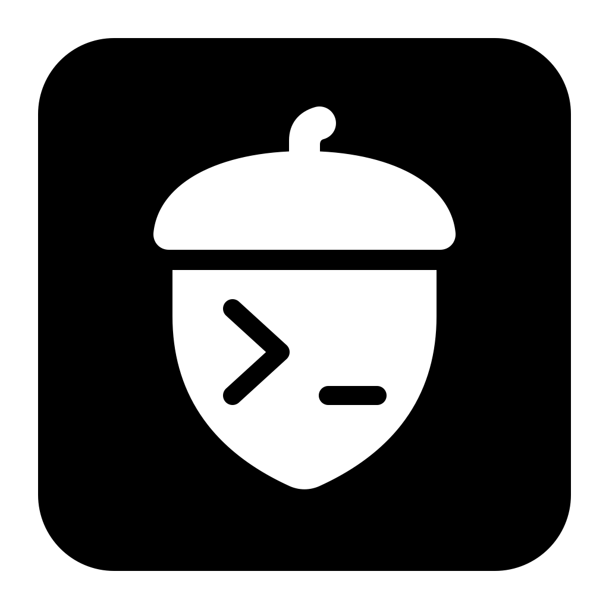

<div align="center">
  
  <h1>Nutty · 坚果终端</h1>
  <p><strong>终端、远程文件与 AI 运维助手，在同一个原生工作区。</strong></p>
  <p>
    
    <a href="LICENSE"></a>
  </p>
</div>

Nutty 是使用 Rust 构建的桌面终端。GPUI 绘制界面，Alacritty 解析终端，russh 处理 SSH/SFTP，Rig 接入模型。

## 特性

- **终端**：macOS、Windows、Linux 本地会话和 SSH；标签与嵌套分屏、广播、搜索；命令历史和目录跟随；中英文字体、光标与主题。
- **图像**：Kitty、Sixel、iTerm 与 Zmodem。单边不超过 4096 像素，不使用共享内存。
- **连接**：密码、私钥、证书、SSH Agent、键盘交互和主机指纹确认；多跳、HTTP CONNECT / SOCKS5、保活与端口转发。可导入 OpenSSH 配置和加密备份。
- **文件**：SFTP 浏览、预览、编辑和权限管理。传输队列支持限速、暂停续传、失败重试和同名冲突处理。
- **AI**：OpenAI、DeepSeek、Anthropic、Gemini、Ollama 及兼容接口；通过 ACP 接入 Cursor、Codex、Claude Code、Gemini CLI、OpenCode。支持 MCP 与 Skills。只读自动发送使用命令白名单，不满足条件时改为手动执行。

## 常用快捷键

| 操作 | macOS | Windows / Linux |
| --- | --- | --- |
| 新建本地终端 | `⌘T` | `Ctrl+Shift+T` |
| 关闭当前窗格 | `⌘W` | `Ctrl+Shift+W` |
| 左右分屏 | `⌘D` | `Ctrl+Shift+D` |
| 上下分屏 | `⌘⇧D` | `Ctrl+Shift+Alt+D` |
| 命令面板 | `⌘K` | `Ctrl+Shift+K` |
| 设置 | `⌘,` | `Ctrl+Shift+,` |

## 从源码构建

使用 Rust stable，工具链要求见 `Cargo.toml`。

```sh
git clone https://github.com/madebynut/nutty.git
cd nutty
cargo run --locked --bin Nutty
```

```sh
sh scripts/bundle-macos.sh release
```

```powershell
./scripts/bundle-windows.ps1 release
```

```sh
sh scripts/bundle-linux.sh release
```

## 许可

[Apache License 2.0](LICENSE) · madebynut

依赖保留各自的许可与著作权。
