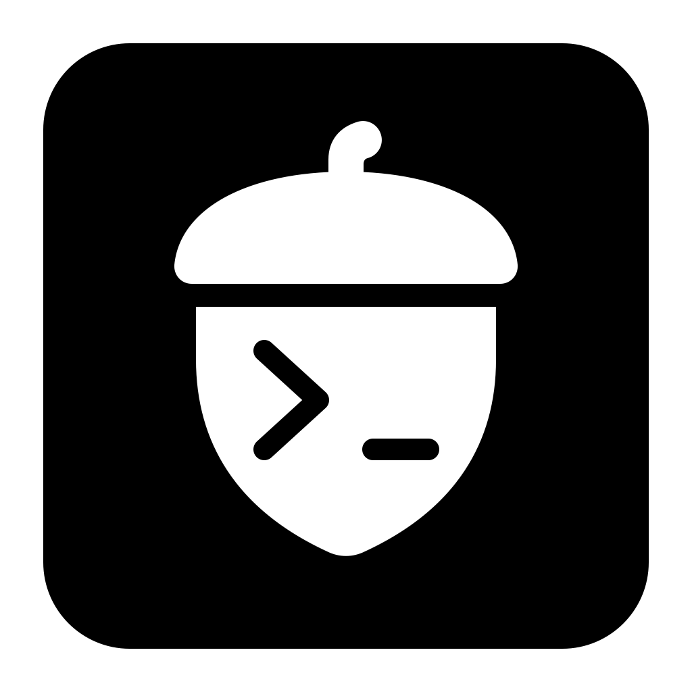
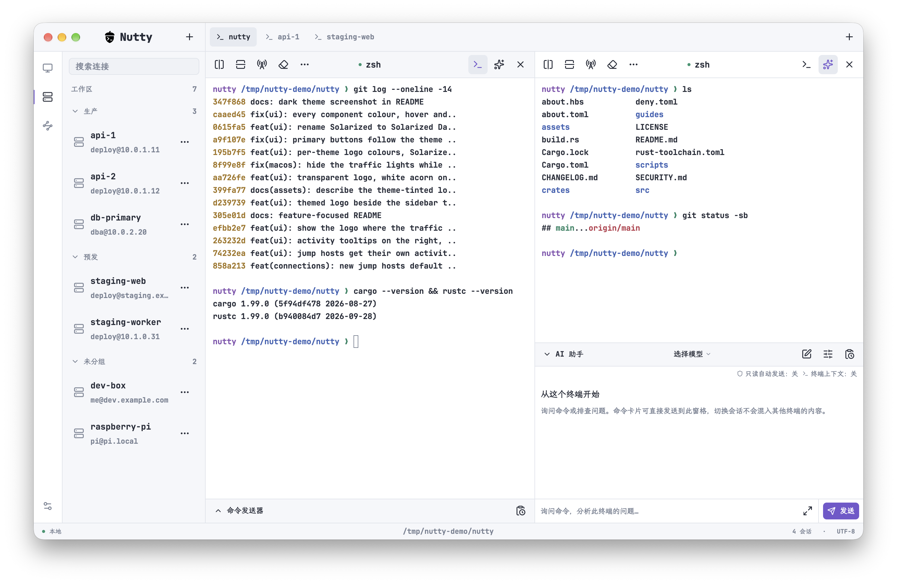

  
  <h1>Nutty · 坚果终端</h1>
  
<strong>终端、远程文件与 AI 运维助手，同在一个原生工作区。</strong>

  

    
    
    
  

  

    <a href="#终端">终端</a> ·
    <a href="#ssh-连接">SSH 连接</a> ·
    <a href="#远程文件">远程文件</a> ·
    <a href="#ai-助手">AI 助手</a> ·
    <a href="#安全与隐私">安全与隐私</a> ·
    <a href="https://github.com/madebynut/nutty/releases">下载</a>
  

 

  <picture>
    <source media="(prefers-color-scheme: dark)" srcset="assets/screenshots/dark.png" />
    
  </picture>

Nutty 是为每天和服务器打交道的人做的桌面终端。本地 Shell、SSH 会话、远程文件和 AI 助手共用一个窗口，也共用同一份上下文：AI 知道当前窗格连的是哪台机器、用的是什么 Shell；文件面板跟着终端的当前目录走；端口转发随连接一起启动和停止。

界面由 GPU 直接绘制，不依赖 Electron 或内嵌浏览器；终端解析使用 [Alacritty](https://github.com/alacritty/alacritty) 的内核，大量输出也能流畅滚动。

<table>
  <tr>
    <td width="33%" valign="top">
      <h3>原生且轻快</h3>
      Rust 编写、GPU 绘制，macOS、Windows、Linux 同一套体验。
    </td>
    <td width="33%" valign="top">
      <h3>懂上下文的 AI</h3>
      每个窗格一个独立会话，建议的命令一键送回终端执行。
    </td>
    <td width="33%" valign="top">
      <h3>默认就安全</h3>
      凭据只存系统钥匙串，远端输出按不可信数据处理。
    </td>
  </tr>
</table>

## 终端

- **Shell 随手切换**：zsh、bash、fish、PowerShell、cmd、WSL 与 Git Bash，都能作为本地会话打开。
- **标签与分屏**：任意嵌套的横竖分屏，可同时向多个窗格广播输入；回滚内容支持搜索。
- **记得你在哪**：Shell 集成实时跟踪当前目录和每条命令的边界，命令历史按窗格保存；重启后标签、分屏和目录原样恢复，SSH 窗格保留布局等待重连。
- **图像与文件传输**：支持 Kitty 图像协议、Sixel、iTerm 内联图像，以及 Zmodem 收发文件。
- **中文排版**：中英文字体分开设置，中文严格按双列宽对齐；行高、字距、光标形状和主题都可以调整。
- **命令发送器**：多行命令、管道和脚本先在输入框里写好，确认后再发到终端。

## SSH 连接

- **全部常见认证方式**：密码、私钥、OpenSSH 证书、SSH Agent 和键盘交互式认证（动态验证码）。
- **主机指纹校验**：首次连接时请你核对指纹，指纹一旦变化直接拒绝连接。
- **跳板与代理**：多级跳板机路由一目了然；支持 HTTP CONNECT 与 SOCKS5 代理，保活、断线自动重连，密钥交换与加密算法可以逐项指定。
- **分组管理**：连接按分组整理、即搜即得，可直接导入 `~/.ssh/config`。
- **端口转发**：本地、远程与动态（SOCKS5）转发，规则可设为连接成功后自动启动。
- **加密备份**：配置和凭据可导出为 Argon2id + AES-256-GCM 加密的备份文件，换机时一次带走。

## 远程文件

- **SFTP 文件面板**：浏览、预览、在线编辑、重命名和修改权限，常用目录可以加书签。
- **跟随终端**：在终端里 `cd` 到哪里，文件面板就打开到哪里。
- **可靠的传输队列**：限速、并发、暂停与续传、失败重试、同名冲突处理一应俱全；下载永远不会覆盖本地已有文件。

## AI 助手

- **每个窗格独立会话**：AI 能看到这个窗格的系统、Shell 和当前目录。终端输出只有在你打开「终端上下文」开关后才会发送。
- **主流模型都能接**：OpenAI、Anthropic、Google Gemini、DeepSeek、Ollama，以及任何兼容 OpenAI 接口的服务。选择模型时，按该模型的能力给出可用的推理强度。
- **接入你已有的 Agent**：通过 [ACP](https://agentclientprotocol.com) 使用 Claude Code、Codex、Cursor、Gemini CLI 与 OpenCode，并支持 MCP 工具和 Skills。
- **命令由你决定**：AI 建议的命令以卡片呈现，点击后才会执行。可选的「只读自动发送」只放行 `ls`、`ps`、`uname` 这类白名单查询命令，并改写为绝对路径和逐词引用；不满足条件的命令一律退回手动确认。

## 安全与隐私

Nutty 默认把远端主机发来的一切都当作不可信数据。

| | |
| --- | --- |
| **凭据** | 只保存在 macOS 钥匙串、Windows 凭据管理器或 Linux Secret Service 中，配置文件里没有明文密码和密钥；钥匙串不可用时也不会退回明文。 |
| **远端输出** | 图像协议只能读取本机的普通文件；Zmodem 只能把文件存到你选的目录，且不覆盖已有文件；读取剪贴板必须确认，写入剪贴板可设为每次询问。 |
| **导入** | 从备份导入的 MCP 服务和 Agent 默认停用，端口转发也不会自动启动，核对后再由你开启。 |
| **风险提示** | 转发监听在 `127.0.0.1` 以外的地址、AI 或 MCP 使用明文 `http://` 时，界面会明确提醒。 |
| **网络** | 除了你配置的服务器、代理和 AI 服务，Nutty 只在启动时向 GitHub 查询一次新版本，不附带个人信息，可在设置中关闭。没有遥测，日志只留在本机。 |

发现安全问题，请按 [SECURITY.md](SECURITY.md) 私下报告。

## 常用快捷键

| 操作 | macOS | Windows / Linux |
| --- | --- | --- |
| 新建本地终端 | `⌘T` | `Ctrl+Shift+T` |
| 左右分屏 | `⌘D` | `Ctrl+Shift+D` |
| 上下分屏 | `⌘⇧D` | `Ctrl+Shift+Alt+D` |
| 关闭当前窗格 | `⌘W` | `Ctrl+Shift+W` |
| 命令面板 | `⌘K` | `Ctrl+Shift+K` |
| 设置 | `⌘,` | `Ctrl+Shift+,` |
| 全部快捷键 | `⌘/` | `Ctrl+Shift+/` |

## 致谢

Nutty 建立在这些优秀的开源项目之上：界面框架 [GPUI](https://www.gpui.rs)，终端内核 [Alacritty](https://github.com/alacritty/alacritty)，SSH 与 SFTP [russh](https://github.com/Eugeny/russh)，模型接入 [Rig](https://github.com/0xPlaygrounds/rig)。

## 许可

[Apache License 2.0](LICENSE) · madebynut

各开源依赖保留其原有许可与著作权，完整清单见发布包内的 `THIRD-PARTY-NOTICES.txt`。版本变化见 [CHANGELOG.md](CHANGELOG.md)。
